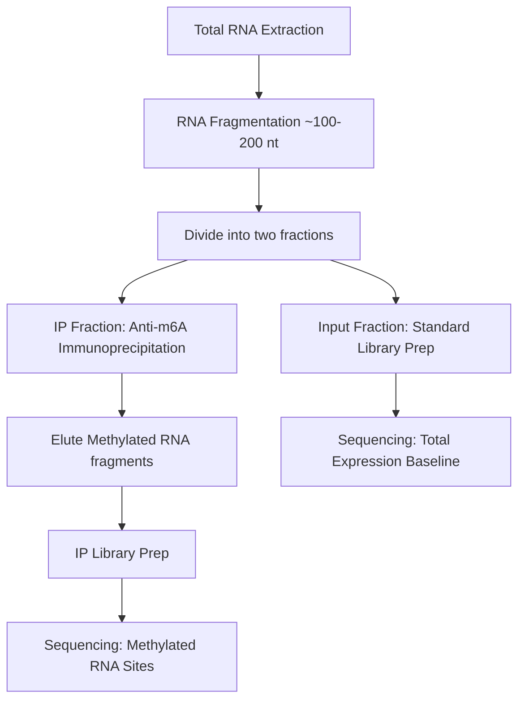

# Understanding RNA-seq vs. MeRIP-seq (m6A-seq)

This document provides the theoretical background explaining the differences between standard **Bulk RNA-seq** (Input fraction) and **MeRIP-seq** (Immunoprecipitation fraction), and how they are used together to analyze RNA methylation dynamics in Major Depressive Disorder (MDD).

---

## 🔬 1. Conceptual Comparison

| Feature                | Bulk RNA-seq (Input Control)                         | MeRIP-seq / m6A-seq (IP Fraction)                              |
| :--------------------- | :--------------------------------------------------- | :------------------------------------------------------------- |
| **Primary Target**     | All transcript molecules in the sample.              | Only transcript fragments containing $m^6A$ modifications.     |
| **Selection Method**   | Poly(A) enrichment or ribosomal RNA depletion.       | Immunoprecipitation using an $m^6A$-specific antibody.         |
| **Output Information** | Total gene/transcript expression levels.             | Absolute abundance of methylated transcripts.                  |
| **Biological Insight** | Transcriptional activation and RNA degradation rate. | Post-transcriptional chemical modification of RNA.             |
| **Typical Analysis**   | Differential Gene Expression (DGE).                  | Peak Calling, Differential Methylation (interaction analysis). |

---

## ⚙️ 2. How MeRIP-seq Works

MeRIP-seq (Methylated RNA Immunoprecipitation Sequencing) is an antibody-based technique used to map $m^6A$ modifications across the transcriptome:



1. **Fragmentation**: RNA is fragmented into short segments (~100–200 nucleotides) before selection. This is critical because the antibody pulls down the entire fragment containing the modification. Fragmenting allows high-resolution localization of the modification site (the "peak").
2. **Immunoprecipitation (IP)**: An antibody specific to $m^6A$ is incubated with the fragments. The antibody-bound fragments are precipitated, and unmethylated fragments are washed away.
3. **Sequencing**: Both the **Input** (unprecipitated total RNA) and **IP** (precipitated methylated RNA) libraries are sequenced.

---

## 🧮 3. Why We Need Both: The Interaction Logic

Analyzing the IP fraction alone is **insufficient** to determine if RNA methylation has changed. Consider the following scenarios:

### Scenario A: Transcriptional Upregulation (No Methylation Change)
* **Control**: 100 transcripts of Gene X. 10 are methylated (10% methylation rate).
  * *Input count* $\propto$ 100, *IP count* $\propto$ 10.
* **MDD**: 200 transcripts of Gene X due to gene activation. 20 are methylated (10% methylation rate).
  * *Input count* $\propto$ 200, *IP count* $\propto$ 20.
* **Result**: The IP signal doubled in MDD. However, the methylation rate remained exactly 10%. This is transcriptional upregulation, not differential methylation.

### Scenario B: Hyper-methylation (True Differential Methylation)
* **Control**: 100 transcripts of Gene X. 10 are methylated (10% methylation rate).
  * *Input count* $\propto$ 100, *IP count* $\propto$ 10.
* **MDD**: 100 transcripts of Gene X. 40 are methylated (40% methylation rate).
  * *Input count* $\propto$ 100, *IP count* $\propto$ 40.
* **Result**: The IP signal quadrupled in MDD while the Input signal remained unchanged. This represents true hyper-methylation of Gene X in MDD.

### Mathematical Normalization via DESeq2
To isolate true methylation changes from changes in gene expression, we test the **interaction term** in a generalized linear model:
$$\text{Design} = \sim \text{Condition} + \text{Fraction} + \text{Condition:Fraction}$$
Where:
* `Condition`: `mdd` vs. `ctrl`
* `Fraction`: `IP` vs. `Input`
* `Condition:Fraction`: The interaction term.

A statistically significant interaction term indicates that the ratio of $\frac{\text{IP}}{\text{Input}}$ differs between MDD and Control, confirming **differential methylation**.

---

## 🧬 4. Variant Calling in Input vs. IP

Performing SNP variant calling on standard RNA-seq vs. MeRIP-seq IP libraries serves two distinct purposes:
1. **Input RNA-seq**: Identifies genomic variants (SNPs) expressed in the subject's brain tissue.
2. **IP Fraction**: Identifies variants present in the methylated pool of transcripts. 
   * By comparing allele ratios in the **IP** vs. **Input** libraries, researchers can detect **Allele-Specific Methylation (ASM)**—where one allele of a heterozygous SNP is preferentially methylated over the other.


### The core distinction: peak-level vs gene-level quantification

This pipeline is **MeRIP-seq** (m6A IP + RNA-seq), not plain RNA-seq. The quantification step works like this:

```
STAR alignment → BAM
       ↓
TRESS peak calling → consensus_peaks.saf
       ↓
featureCounts -F SAF → counts per peak ("peak_1", "peak_2", ...)
```

The `consensus_peaks.saf` defines **narrow genomic windows** where m6A modifications are detected across the cohort. These are not genes — they are methylation loci. A single gene can have 3, 5, or 10 peaks across its transcript body, all with independent methylation profiles.

### Why the original script failed

The original `01_gene_mapping.R` was written assuming a **standard gene-level RNA-seq** workflow:

```
featureCounts -a genome.gtf → ENSG00000141510, ENSG00000183722, ...
                                      ↓
                          BioMart lookup by Ensembl ID
                                      ↓
                               HGNC symbol, biotype
```

BioMart's `ensembl_gene_id` filter only accepts `ENSG...` accessions. Passing `peak_1`, `peak_2` returns 0 rows — those IDs don't exist in Ensembl.

### Why the new approach is correct

The new script does what the biology requires:

```
peak_1 (chr19:71006-71355) → BioMart chromosomal_region query
                                      ↓
                         Find protein-coding gene overlapping that locus
                                      ↓
                               e.g., ENSG → PCSK9
```

Then multiple peaks mapping to the same gene are **summed**, giving you a gene-level count matrix that represents the total m6A signal per gene — which is what DESeq2 needs for the DGE test. This is exactly the same logic as what tools like exomePeak2 and MeTPeak do internally.

In short: the old script assumed the data came from RNA-seq. The new script correctly treats it as MeRIP-seq peak-level data and maps it back to genes by genomic coordinates.