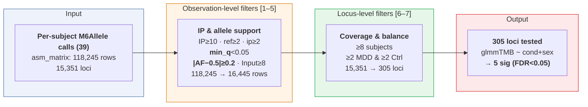

# ASM Group-Comparison Filtering Flow

*Source: `11_asm_build_matrix.py` log (2026-08-03 10:26) for the upstream build; `12_asm_compare.R` (`include_obs`, `analyze`) for the filters applied to `_data/RData/03_variant_calling/asm_matrix.tsv`. Counts from the sex-adjusted run of 2026-08-03.*

## Notes

- **Upstream build** (`11_asm_build_matrix.py`): 118,245 matrix rows = 139,995 asmPeak rows − 21,750 duplicate-coordinate rows. ASE site counts were 2,248,869 (IP) and 3,851,564 (Input) pre-aggregation.
- **Only 15,351 of the 33,123 consensus loci (46%) have any subject rows** — the rest lack heterozygous-SNP/peak coverage in all 39 subjects.
- The binding constraint is **per-locus subject coverage** (steps 6–7), not read depth: a locus is only present for a subject if that subject is heterozygous at that position, so most loci have reads in only 2–7 subjects.
- The **skew filter** is the largest single cut (79% of rows) — `|AF − 0.5| ≥ 0.2` from §4.2 of `docs/asm_analysis_methodology.md`.
- Sensitivity sweep (`12_asm_compare.R`), `n_loci` across skew ∈ {0.1, 0.2, 0.3}: `min_subjects=6` → 298–1230 (489 at default 0.2); `min_subjects=12` → 75–244 (124 at default 0.2); default `min_subjects=8` → 305 (180–678).
- Engine/contrast: `glmmTMB` betabinomial, `cbind(ip_ref, ip_b) ~ condition + sex + offset(logit Input AF)`; sex dropped when a locus has a single sex.