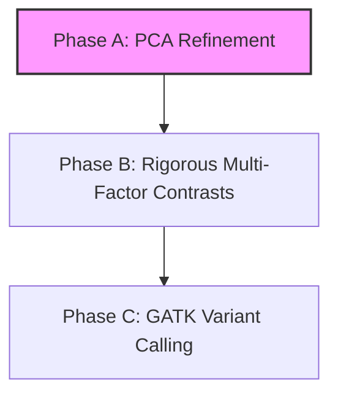

# Transcriptomic & Epitranscriptomic Pipeline Implementation Plan

This document outlines the step-by-step strategy to implement three key enhancements for the Major Depressive Disorder (MDD) prefrontal cortex MeRIP-seq cohort.

---

## 🗺️ Execution Roadmap

---

## 🔍 Pipeline Status & Gap Analysis

The tables below map the starting pipeline limitations (what is/was there vs. what is missing) to the proposed enhancements.

### 🎨 Phase A: PCA Analysis Refinement (Active Focus)

| Component | Current State | What's Missing / Incorrect | Proposed Changes |
| :--- | :--- | :--- | :--- |
| **Gene Input** | Uses **all 20,000+ genes** | High-expression background noise and non-varying genes dilute the variance, masking the biological signal. | Filter the VST matrix to use only the **top 500 or 1000 most variable genes** (standard in transcriptomics). |
| **Scaling** | `scale. = TRUE` | Over-scaling: divides by standard deviation, inflating low-level noise and deflating real biological expression shifts. | Set `scale. = FALSE` (standard for VST/rlog data since variance is already stabilized). |
| **Metadata Factors** | Only considers `SampleType` (MDD vs. Control). | **Gender (Sex)** is completely ignored, despite being a major driver of expression variance in the brain. | Add **Gender** as a factor; color-code/shape samples by both `SampleType` and `Gender` to check for sex-specific clusters. |
| **Batch Verification** | No check for technical covariates. | No way to tell if samples cluster by technical batches (e.g. sequencing date, flowcell). | Add batch variables to the metadata mapping and overlay them on the PCA plot. |

### 🧪 Phase B: Rigorous Multi-Factor Contrasts

| Contrast Type | Current State | What's Missing | Proposed Changes |
| :--- | :--- | :--- | :--- |
| **Sex-Specific contrasts** | Runs a single global model comparing **all MDD vs. all Control** (pooling males and females). | Pooling males and females washes out the transcriptomic signal because MDD signatures in the prefrontal cortex are highly sex-specific. | Stratify the analysis: run **Male-only (MDD vs. Control)** and **Female-only (MDD vs. Control)** separately. |
| **MeRIP-seq Interaction** | Evaluates MDD vs. Control in `RNAseq` (Input) and `RIPseq` (IP) **independently**. | Looking at IP alone doesn't show methylation changes—it could just show baseline transcription changes. | Implement the **interaction model**: `~ Condition + Fraction + Condition:Fraction`. This isolates *true relative methylation* changes ($m^6A$ level changes independent of underlying gene expression). |
| **Significance Thresholds** | Hardcoded strict filter: `|LFC| >= 1` (2-fold change) and `p < 0.05`. | For psychiatric disorders, fold changes are rarely >= 2. Under these strict filters, you get **zero DEGs**. | Relax the threshold to Adjusted P-value (FDR) `< 0.05` (or `< 0.1`) with a lower LFC limit (e.g. `|LFC| >= 0.2` or `0.3`) or no LFC limit. |

### 🧬 Phase C: GATK Variant Calling Workflow

| Component | Current State | What's Missing | Proposed Changes |
| :--- | :--- | :--- | :--- |
| **Pipeline Scripts** | **Empty directory**: contains only helper text files ([MarkDuplicates.txt](../03_variant_calling/MarkDuplicates.txt) and [ReadGroups.txt](../03_variant_calling/ReadGroups.txt)). | The entire GATK variant calling pipeline for RNA-seq is completely unwritten. | Create a structured workflow following GATK Best Practices:  1. **`01_split_n_cigar.sh`**: Splitting splice-junction reads. 2. **`02_haplotype_caller.sh`**: Running parallel variant calling on BAMs. 3. **`03_variant_filtration.sh`**: Hard-filtering SNPs for RNA-seq. |
| **Ref Databases** | Unknown local paths for GATK known sites. | Need to check if local databases (dbSNP, 1000 Genomes VCFs) exist on the server to enable BQSR. | Search the server or build direct commands to download known variant databases, or design the scripts to skip BQSR if resource-limited. |

---

## 🎨 Phase A Detail: PCA Analysis Refinement

### Objectives
To accurately visualize the high-dimensional transcriptomic space without noise dilution, verify technical/biological factors, and determine if sample subgroups cluster together.

### Tasks
1. **Top Variable Gene Selection**: Filter the expression matrix to keep only the top $N$ (e.g., 500 and 1000) most variable genes across samples, resolving the noise dilution problem.
2. **Standardize Scaling**: Disable auto-scaling (`scale. = FALSE` in `prcomp()`) to preserve the physical magnitude of VST/rlog-transformed variances.
3. **Incorporate Gender Factor**: Align the `Gender` column from metadata and include it in PCA visualization.
4. **Multi-Factor Visualization**: Generate 2D and 3D PCA plot widgets coloring samples by combined groups (`Male MDD`, `Male Control`, `Female MDD`, `Female Control`) and by technical covariates (Bases, Spots) to check for batch effects.

---

## 🧪 Phase B Detail: Rigorous Multi-Factor Contrasts

To dissect MeRIP-seq data properly, we must model three intersecting factors:
1. **Gender** ($G$): `male` vs. `female`
2. **Condition** ($C$): `mdd` vs. `ctrl`
3. **Fraction** ($F$): `m6A` (IP) vs. `RNA-seq` (Input)

### Contrasts to Implement
We will design a multi-factor generalized linear model in DESeq2:

#### 1. Baseline Differential Expression (DGE - Input Only)
Isolates transcript levels inside the `RNA-seq` fraction:
* **Male MDD vs. Control**: `Input_Male_MDD` vs. `Input_Male_Ctrl`
* **Female MDD vs. Control**: `Input_Female_MDD` vs. `Input_Female_Ctrl`
* **Sex-Differential Response (Interaction)**: `(Input_Male_MDD - Input_Male_Ctrl) - (Input_Female_MDD - Input_Female_Ctrl)`
  * *Evaluates if MDD changes genes differently in males vs. females.*

#### 2. Relative Methylation Splicing/Interaction (m6A Level Changes)
Measures true post-transcriptional $m^6A$ methylation levels, correcting for underlying expression.
Using the formula: `~ Subject + Fraction` (paired per subject) or `~ Gender + Condition + Fraction + Gender:Condition + Gender:Fraction + Condition:Fraction + Gender:Condition:Fraction`:
* **Male Relative Methylation Change**: Interaction of `Condition` x `Fraction` inside males.
* **Female Relative Methylation Change**: Interaction of `Condition` x `Fraction` inside females.
* **Three-way Interaction (Sex-specific Methylation Change)**: `Gender` x `Condition` x `Fraction`
  * *Evaluates if a gene is methylated differently in response to MDD in a male-specific or female-specific manner.*

---

## 🧬 Phase C Detail: GATK Variant Calling Workflow

To identify genetic loci modifying methylation or showing allele-specific dynamics:
1. **Splice Junction Splitting**: Write `01_split_n_cigar.sh` to run GATK `SplitNCigarReads` to handle RNA-seq spliced alignments.
2. **Parallel Variant Calling**: Write `02_haplotype_caller.sh` to run GATK `HaplotypeCaller` across samples.
3. **SNP Quality Filtration**: Write `03_variant_filtration.sh` to apply standard GATK RNA-seq hard-filters (`FS > 30.0`, `QD < 2.0`).
4. **m6A-SNP & ASM Mapping**:
   * Intersect SNPs with consensus `DRACH` motifs.
   * Compare allele ratios in MeRIP IP fractions vs. Input fractions to map Allele-Specific Methylation (ASM).
